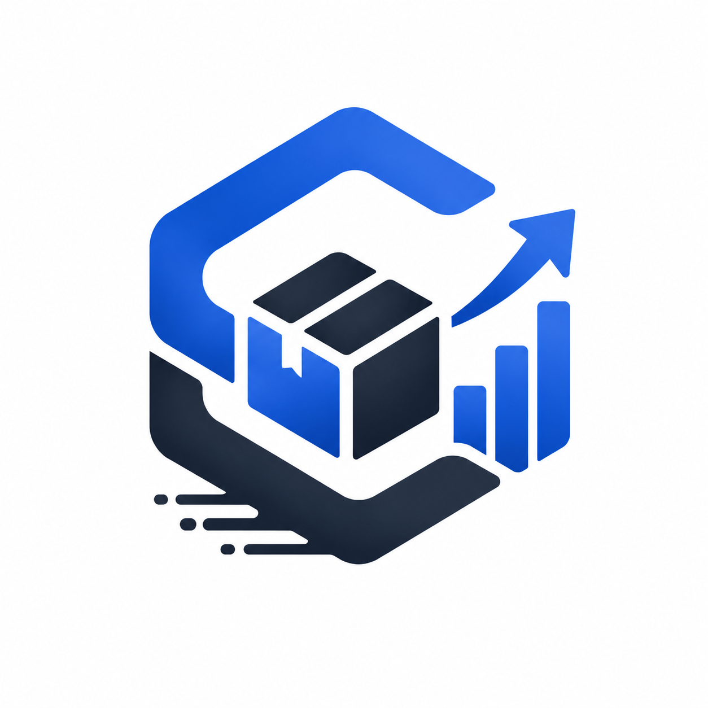

<p align="center">
  
</p>

<h1 align="center">StockFlow</h1>

<p align="center">
  Batch-based inventory, sales, credit, and profit tracking for small shops.
</p>

<p align="center">
  Next.js 16 · React 19 · TypeScript · Tailwind CSS 4 · Supabase · Vercel
</p>

---

StockFlow is a multi-tenant web app for small businesses. It was built first
for Philippine auto-parts shops. Many shops share one deployment, and each
shop sees only its own products, stock, sales, customers, and reports. Row
Level Security in the database enforces the separation.

It is built around how small shops actually work:

- The same item arrives at different prices.
- Customers buy on credit (*utang*) and pay in installments.
- Mistakes at the counter need to be fixed without rewriting history.

## Contents

- [Features](#features)
- [Roles and permissions](#roles-and-permissions)
- [Tech stack](#tech-stack)
- [Getting started](#getting-started)
- [Database](#database)
- [Project structure](#project-structure)
- [Business rules](#business-rules)
- [Development workflow](#development-workflow)
- [Deployment](#deployment)
- [Known limitations](#known-limitations)
- [Documentation](#documentation)

## Features

**Inventory**

- Products and categories.
- Stock received in **batches**. Each arrival keeps its own capital price,
  markup, and selling price, and old prices are never overwritten.
- FIFO deduction by default, or pick a specific batch at the till.
- Stock adjustments (damage, loss, recount) with a required reason. Each
  adjustment and its stock change are saved together in one transaction.
- Sold-out batches stay as history, and products with batch history cannot
  be deleted.
- Inventory search, category and stock-status filters, and sorting.

**Sales**

- The till searches products, picks batches, accepts a manual price override,
  and calculates actual profit.
- Sales can be paid, partially paid, or on credit.
- **Duplicate-submission protection.** If the connection drops and the
  cashier taps *Record* again, the sale is recorded once.
- Voiding returns the stock to its original batches and keeps the sale as a
  record.
- Amendments void the original and create a linked replacement that keeps the
  original sale date.

**Customer credit**

- One account per customer, with a combined list of every credited item, the
  total credited, the total paid, and the balance.
- Installments are entered against the total balance and applied to the
  oldest unpaid sale first.
- Duplicate-submission protection for payments.
- The date the money was received is tracked separately from the date it was
  entered.

**Expenses**

- Record operating costs for today or a past date. Expenses reduce net
  profit.
- Soft delete, plus a **change history** of every edit and deletion, with the
  previous values, who made the change, and when.

**Reports**

- Dashboard summary and on-screen reports for today, the last 7 days, the
  last 30 days, this month, or a custom range of up to 92 days.
- Per-day detail with sales, collections, and expenses.
- PDF export for a single day, the current week, or the current month,
  generated on demand and never stored.
- Revenue uses the sale date, and collections use the date the money was
  received.

## Roles and permissions

| Capability | Owner | Assistant |
|---|:-:|:-:|
| View products, inventory, sales, reports | ✅ | ✅ |
| Receive stock (new batches) | ✅ | ✅ |
| Record sales and choose batches | ✅ | ✅ |
| Add customers and record credit payments | ✅ | ✅ |
| Record, edit, and delete expenses (with history) | ✅ | ✅ |
| Create, edit, or delete products and categories | ✅ | — |
| Adjust stock | ✅ | — |
| Void or amend a sale | ✅ | — |
| Edit or remove customers | ✅ | — |
| Manage assistants (max 2 active) and shop settings | ✅ | — |

**Super admin** is the platform role. It manages shops and user accounts and
sees platform metrics only. It has **no access** to any shop's inventory,
sales, or financial data.

Each page checks the role on the server, and the database repeats the same
checks through RLS. Hiding a link in the sidebar is never the only
protection.

## Tech stack

| Area | Technology |
|---|---|
| Framework | [Next.js](https://nextjs.org) 16 (App Router, Server Components, Server Actions) |
| UI | React 19, Tailwind CSS 4, `motion` |
| Language | TypeScript 5 |
| Database and auth | [Supabase](https://supabase.com): PostgreSQL 17, Supabase Auth, Row Level Security |
| Business logic | PostgreSQL `SECURITY DEFINER` functions for multi-row operations: sales, payments, voids, amendments, and stock adjustments |
| PDF | PDFKit (generated in memory) |
| Hosting | Vercel (Production deploys from `main`) |

All dates and reports use **Philippine time (Asia/Manila)**.

## Getting started

### Requirements

- Node.js **20.9 or newer**
- npm
- A Supabase project
- The [Supabase CLI](https://supabase.com/docs/guides/cli). It is included as
  a dev dependency and runs with `npx supabase`.

### 1. Install

```bash
git clone https://github.com/adrianniel/stockflow.git
cd stockflow
npm install
```

### 2. Configure environment variables

Copy `.env.example` to `.env.local` and fill in the values from **Supabase
Dashboard → Project Settings → API**:

```env
NEXT_PUBLIC_SUPABASE_URL=https://your-project-ref.supabase.co
NEXT_PUBLIC_SUPABASE_PUBLISHABLE_KEY=your-publishable-anon-key
```

These are the only two variables the app uses. The publishable key is safe in
the browser, because RLS protects the data.

> **Never** add a Supabase `service_role` key to this project. It bypasses RLS
> and would let any shop read every other shop's data.

### 3. Set up the database

Apply the migrations to your Supabase project. See [Database](#database).

### 4. Run

```bash
npm run dev
```

Open <http://localhost:3000>.

### Scripts

| Command | What it does |
|---|---|
| `npm run dev` | Start the development server |
| `npm run build` | Production build |
| `npm run start` | Serve the production build |
| `npm run lint` | ESLint |
| `npm run typecheck` | TypeScript check (`tsc --noEmit`) |
| `npm run verify` | Typecheck, lint, and build. **Run before every commit.** |

## Database

The schema lives entirely in [`supabase/migrations/`](supabase/migrations/),
applied in filename order. The migrations cover:

- **Core:** shops, users, categories, products, stock batches, sales, sale
  items, stock adjustments, RLS policies, and helper functions.
- **Sales:** `record_sale()` with FIFO or explicit-batch deduction under row
  locks, and `record_sale_once()` for duplicate-safe recording.
- **Credit:** customers, the `sale_payments` ledger with derived
  `amount_paid` and `payment_status`, `record_payment()`,
  `record_customer_payment()` (oldest-sale-first allocation), and
  `record_customer_payment_once()`.
- **Corrections:** `void_sale()`, `amend_sale()`, and `adjust_stock()`.
- **Expenses:** soft-deleted `expenses` and the append-only `expense_history`
  log.
- **Protection:** sold-out batches can't be deleted, products with history
  can't be deleted, the 2-assistant cap, and shop status is platform-only.

### New project

Apply every migration in order, either with `npx supabase db push` against
your linked project or by pasting each file into the Supabase SQL editor.
Then run the verification query:

```bash
npx supabase db query --linked --file docs/verify-setup.sql
```

Every row must read `PASS`. A `FAIL` row names the missing migration and what
breaks without it.

### Existing (live) project

StockFlow holds real business records, so treat every database change as
production work:

1. **Back up first** (schema, data, and auth data) to a private folder
   outside the repository.
2. Check what is applied: `npx supabase migration list --linked`.
3. Test the new migration on a disposable local database.
4. Preview it: `npx supabase db push --linked --dry-run`. It must list
   **only** the intended migration.
5. Apply it, then run `docs/verify-setup.sql`. Every row must be `PASS`.
6. Deploy the app only after that.

Migrations are **additive**: new columns are nullable, new functions and
tables are added, and existing rows are never rewritten or backfilled. The
full procedure is in [`docs/SETUP.md`](docs/SETUP.md).

## Project structure

```text
app/
  page.tsx                    Public landing page
  login/                      Sign-in
  dashboard/                  Authenticated app (one route per feature)
    page.tsx                  Redirects to the role's home dashboard
    owner/ assistant/ admin/  Role dashboards
    products/ categories/ inventory/ adjustments/
    sales/                    Sales list, detail, void, amend
    sales/new/                The till
    credit/                   Customers and credit accounts
    expenses/                 Expenses and change history
    reports/                  Reports and per-day detail
    assistants/ settings/ shops/ users/
  api/reports/sales-export/   PDF export endpoint
components/                   Reusable UI and dashboard components
lib/
  auth/                       requireSession / requireRole, role definitions
  supabase/                   Supabase clients, env access, paged reader
  shop/                       Server actions, queries, reports, validation
  admin/                      Platform-admin actions and metrics
  reports/                    PDF rendering
  updates/                    Release announcement copy
supabase/migrations/          Database schema (source of truth)
docs/                         Requirements, database design, setup, verification
middleware.ts                 Supabase session refresh
```

**How a request flows:** a page calls `requireRole()` and reads through
`lib/shop/queries.ts` using the signed-in user's session, so RLS applies.
Forms post to Server Actions in `lib/shop/actions.ts`, which validate input
and call a database function for any multi-row operation. The shop is always
taken from the session, never from the request.

## Business rules

- Inventory is batch-based, and historical prices and batches are never
  overwritten or deleted.
- FIFO applies unless a batch is explicitly selected.
- Sales record the price actually charged. Selling below cost is allowed and
  is recorded as a loss.
- Sales are **voided, never deleted**. Amendments keep the original as a
  voided record.
- `amount_paid` and `payment_status` are derived from the payment ledger and
  are never written directly.
- Voided sales and their payments are excluded from every report.
- Net profit = sales profit − active expenses.
- Refunds and overpayments are out of scope for now.

The full requirements are in [`docs/SRS.md`](docs/SRS.md).

## Development workflow

1. Branch from `main`.
2. Keep business logic out of UI components. Use the existing helpers
   (`requireRole`, `getShopContext`, `fetchAllRows`, `money`, `dateKey`) and
   filter every query by the session's shop.
3. Run `npm run verify` (there is no automated test suite yet). Test database
   functions on a disposable local PostgreSQL with success, rejection, and
   cross-shop cases.
4. Update the relevant docs in `docs/` alongside the change.
5. Use conventional commits (`feat:`, `fix:`, `docs:`, `chore:`).

## Deployment

StockFlow runs on **Vercel** with **Supabase**:

1. Apply and verify the database migrations first (see [Database](#database)).
2. In Vercel, set `NEXT_PUBLIC_SUPABASE_URL` and
   `NEXT_PUBLIC_SUPABASE_PUBLISHABLE_KEY`.
3. In Supabase Auth, set the production Site URL and redirect URLs.
4. Push to `main`. Vercel builds and deploys Production.
5. Confirm the deployment succeeded in Vercel, then check the owner,
   assistant, and cross-shop flows.

## Known limitations

- No refund or overpayment workflow.
- PDF export covers a day, the current week, or the current month. There is
  no custom-range PDF.
- On-screen reports cover at most 92 days per range.
- Inventory filtering runs in the browser after the shop's inventory loads.
- No in-app password reset or email change.
- No automated test suite.

## Documentation

| Document | Contents |
|---|---|
| [`docs/SRS.md`](docs/SRS.md) | Functional requirements and business rules |
| [`docs/DATABASE.md`](docs/DATABASE.md) | Database design, tables, and data rules |
| [`docs/database-migrations.md`](docs/database-migrations.md) | Migration history and the reasoning behind each change |
| [`docs/SETUP.md`](docs/SETUP.md) | Supabase setup, live-database procedure, and deployment |
| [`docs/verify-setup.sql`](docs/verify-setup.sql) | Read-only checks that the database matches what the app expects |
